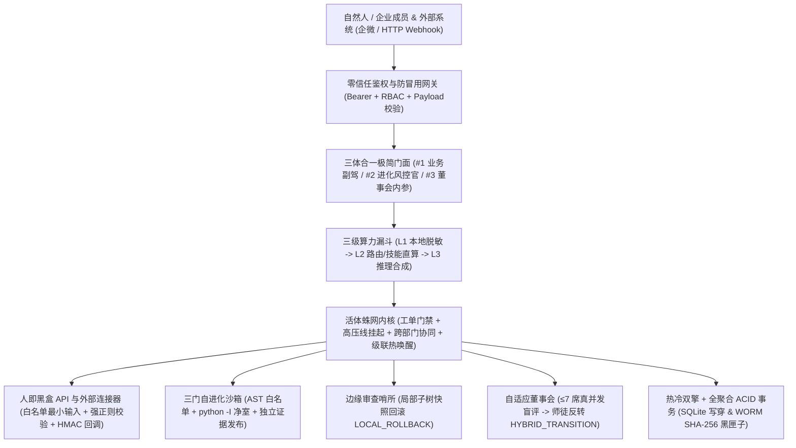
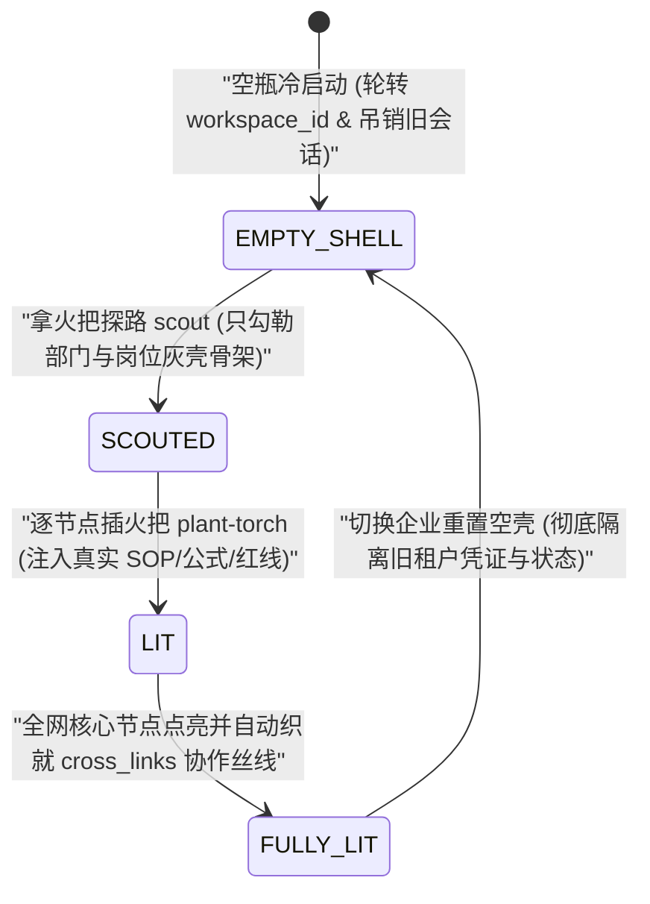
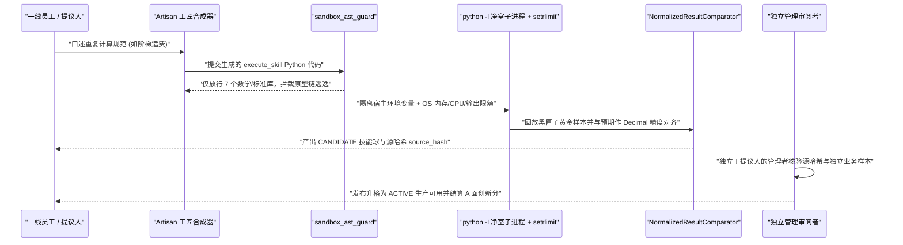

# 🕸️ Arachne-OS 核心设计理念、架构哲学与工程铁律总纲（Workflow 交接完备版）

> **文档定位**：本文档凝练并整合了 **Arachne-OS（活体蛛网式自进化多智能体企业操作系统）** 从 M1 原型奠基、M16 矿洞探路范式、M17–M19 生产级去耦合，到 M20–M33 安全/事务/证据/连续性全面硬化期间沉淀的**全部设计哲学、组织隐喻、系统架构、状态机契约与零妥协工程铁律**。  
> **适用场景**：作为后续开启 **Workflow 模式** 的唯一权威设计基准（Single Source of Truth），确保后续任何增量开发、架构演进或自动化编排均严丝合缝地延续原有灵魂，而不发生“退化回死板表单 SaaS”或“滑向无约束自由聊天 Agent”的架构漂移。

---

## 第一章：第一性原理与终极愿景（Core Vision & First Principles）

Arachne-OS 的诞生源于对当代两类主流企业软件范式的彻底反思与否定：

1. **否定传统静态表单 SaaS / ERP（静态死网）**：传统系统将企业流程焊死在预先定义的表结构、菜单与固定审批流中，既无法吸收员工日常口头摸索出的隐性经验（Tacit Knowledge），也无法随组织业务扩张自适应生长，面对跨部门例外与高频规则变更只能反复排期开发。
2. **否定失控自由聊天 Agent（黑盒裸奔）**：通用大模型对话机器人直接裸连企业权限或业务动作，极易在提示词注入、算术幻觉、状态竞态与越权询问下直接击穿底价红线、泄露商业绝密、误发外部指令或污染生产账本。

**Arachne-OS 的终极定位**：将真实企业建模为一张**“活体生长、权责对等、可物理隔离、可外科手术式自愈、并支持人机渐进交棒”的数字蛛网操作系统（Living Spider-Web Enterprise OS）**。全系统严格建立在三大不可动摇的第一性原理之上：

### 1.1 原理一：组织资产归「岗」不归「人」（岗人分离，铁打工位流水兵）
企业真正核心的生产力资产（行业 SOP、计价公式、风险红线、跨系统审批权柄、历史客户坑点经验）**严禁绑定在某个自然人的大脑或私人微信聊天记录中**，而必须原子化封装后挂载在标准岗位单元容器（`UnitSlot`）上。人员入职、休假、替班、离职只是“容器驻留者（Occupant）”的受控切换——新员工接管工位即可零折损继承全套合规工作记忆与工具链，离职者旧会话与访问凭证毫秒级物理吊销，实现**“一键换人不丢球、离岗交接零泄密”**。

### 1.2 原理二：渐进式「师徒反转」演化哲学（从副驾陪跑到自治托管）
Arachne-OS 坚决反对脱离真实业务的“一刀切 AI 替代”，而是设计了一套兼顾组织心理学与工程可控性的**四阶段渐进式接棒曲线**：
1. **`HUMAN`（纯人在岗 · 经验沉淀期）**：真人借助 `#1 业务副驾` 处理日常工单，系统在旁脱敏记账并累计影子对照样本；同时员工将日常重复劳动口述给 `#2 进化与风控官`，现场锻造确定性工具换取正面激励积分。
2. **影子陪跑与双轨校验（Shadow Trial & Calibration）**：AI 针对工单同步输出影子草稿，由**独立复核人**对照真人最终定稿计算采纳吻合度；可替代度依据技能覆盖率、低改动采纳率与异常合规纪律三维量化抬升。
3. **`HYBRID_TRANSITION`（师徒反转 · 人机协同主政期）**：经由多席位独立董事会盲评与顶层拍板批准，工位状态正式翻转——**AI 主办常规标准化流水线，真人退居监督席位专注高主观协商与高压线特批**。
4. **`AGENT`（全自治值守 + 黑盒牌照节点）**：高度确定的工位由受限智能体 7x24 值守；而法律签章、数电专票开具、大额资金拨付、高压线终裁等需要承担法定责任或高度主观博弈的节点，永久保留为 **「人即黑盒 API」（`BLACKBOX_HUMAN`）** 与 **顶层董事会**。

### 1.3 原理三：用「确定性铁笼」严格包裹「概率性智能」
在 Arachne-OS 中，大模型（LLM）**绝对不直接持有终极裁决权、算术最终解释权与持久化写入权**：
- LLM 仅负责：**矿洞组织语义探路、非结构化微信转发清洗、意图识别与路由、多视角思辨辩论、Python 算子代码起草**。
- 凡涉及**商业计价、权限边界、底价保密、数电发票核验、外部回调签名、全库事务回滚、审计留痕**，100% 锁死在**确定性 Python 净室沙箱 + Pydantic 字节级物理脱敏 + HMAC-SHA256 签名 + SQLite ACID 事务日志 + WORM 不可篡改哈希链**构筑的工程铁笼内。

---

## 第二章：组织本体论——容器（Slot）× 粒子（Ball）× A/B 双面画像

Arachne-OS 拆解企业运作的最底层元模型由三大核心原语正交构成：承载权责的**工位容器**、封装知识的**原子粒子**、兼顾激励与风控的**双面画像**。

### 2.1 标准岗位单元容器（`UnitSlot`）
对应源码：[containers.py](file:///Users/Apple/Desktop/公司/arachne-os/backend/core/containers.py)、[schemas.py](file:///Users/Apple/Desktop/公司/arachne-os/backend/core/schemas.py)。

| 核心属性/机制 | 设计语义与工程约束 |
| :--- | :--- |
| `slot_id` / `department` | 企业组织内的唯一物理工位标识，支持多租户探网/创世动态生成与节点映射表同步，严禁在核心逻辑中硬编码特定样本工位 ID。 |
| `ball_ids` | 长期资产列表——知识、代码算子与审批权柄永久归属工位，而不随人员姓名变更而销毁。 |
| `occupant_type` & `occupant_id` | 驻留模式枚举 `HUMAN \| HYBRID_TRANSITION \| AGENT`，以及当前在岗人员 `user_id`。 |
| `BorrowedBallLease`（跨岗借球租约） | 当一线工位临时需要其他部门或主管的高阶技能时，按最小权限原则签发带 `expires_at`（TTL）的临时租约，到期自动惰性回收；**`REDLINE` 红线资产严禁通过任何借球入口外借**。 |
| 岗人无损交接协议（Handover） | 支持三种受控切换：`LEAVE_DELEGATION`（休假代班）、`TEMP_RELIEF`（临时顶岗）、`RESIGN_HANDOVER`（离职交接）。离职交接自动冻结旧人 `_disabled` 状态、吊销全部旧 Token 会话、打上 `（已离岗交接）` 标记，同时由接任者无损继承原工位 `ball_ids` 与待办流转，并支持交接时直接签发 `initial_password`。 |

### 2.2 四类原子权能小球（`CapabilityBall`）
对应源码：[particles.py](file:///Users/Apple/Desktop/公司/arachne-os/backend/core/particles.py)、[auth_custody.py](file:///Users/Apple/Desktop/公司/arachne-os/backend/core/auth_custody.py)。

企业的一切显性规范与隐性能力均被颗粒化为四种互斥类型的原子小球：

| 粒子类型 | 哲学隐喻与核心作用 | 安全边界与生命周期约束 |
| :--- | :--- | :--- |
| **`DATA`** | 业务主数据、标准价格目录、安全库存公式、记忆蒸馏沉淀晶核 | 按 `owner_slot_ids` 与借用租约可见；未挂载球面向普通员工物理不可读正文，防止越权窥探全公司商业档案。 |
| **`SKILL`** | 真实可执行的确定性 Python 计算算子（如阶梯计价、运费、返利对冲） | 遵循 `CANDIDATE -> ACTIVE -> DEPRECATED` 严格状态机；**所有新锻造或模板合成技能必须先落为 `CANDIDATE`，经独立核验批准后方可晋升 `ACTIVE` 挂载使用**。 |
| **`AUTHORITY`** | 特批折扣权柄、跨仓紧急调拨权限、预算放行凭证 | 受分管托管人（Custodian）机制约束：员工发起申请 `BallAccessRequestItem` -> 按直属主管链条精确路由给分管负责人审批/派发/收回；**严禁申请人自批自审，也严禁非最高管理席位越权接管或授予超越其职权的资产**。 |
| **`REDLINE`** | 出厂 BOM 绝密底价、供应商长协成本、法务无限连带责任禁区、客户隐私 | **最高密级物理隔离**：仅受信任的实时 `boss` 角色容器（由容器与档案双重解析校验，而非仅看 `owner_slot_ids` 标签）有权限阅读正文；对其他任何岗位均在命中关键词/语义时立即拦截工单、触发告警脉冲并记入违规探针。 |

**轻量向量化引擎**：`ParticleEngine` 内置基于字符级 unigram/bigram 哈希投影的本地 L2 归一化编码器（`_char_ngram_vector`）与 numpy 余弦相似度检索，实现零外部 Embedding API 依赖下的毫秒级语义召回与标签共现分析。

### 2.3 A/B 双面反推简历画像与物理裁剪铁律
对应源码：[schemas.py](file:///Users/Apple/Desktop/公司/arachne-os/backend/core/schemas.py)、[scoring_engine.py](file:///Users/Apple/Desktop/公司/arachne-os/backend/swarm/scoring_engine.py)。

为了打破“让员工贡献经验做自动化等于让员工自己淘汰自己”的人性悖论，Arachne-OS 为每个企业成员维护互斥投影的两面画像（`DualEmployeeProfile`）：
1. **A 面（员工激励与赋能面 · `EmployeeViewA`）**：公开给员工本人查看。记录个人技能标签、`saved_hours`（自动工具累计节省工时）、`evolution_contributions`（主动提议铸造的技能贡献列表）与 **`innovation_bonus`（经验贡献与效率创新正向绩效分）**。每当员工把繁琐手工规则通过 `#2 进化与风控官` 锻造成 `SKILL` 球，其 A 面创新分与个人收益显著上涨。
2. **B 面（管理治理解构面 · `ManagementViewB` + 三维可替代分）**：仅向管理层开放。包含 `avg_latency_ms`、返工率 `rework_rate`、`boundary_probes`（越界试探红线次数，触碰即扣减综合绩效分）、基础履约分及三维可解释替代度分解模型（`replaceability_breakdown`）：
   - `skill_coverage`：该工位挂载的可执行 `SKILL` 算子对日常高频规则的覆盖率；
   - `shadow_adoption_rate`：由独立复核人记录的「AI 草稿 vs 真人最终文本」相似度与低改动直接采纳率；
   - `exception_discipline_factor`：异常升级纪律与红线零违规稳定度；针对强客诉安抚、大客户博弈等**高主观协商类工位设置人工安全上限阈值**，拒绝机械地将所有岗位强行推算至 100% 可替代。
3. **出口字节级物理脱敏铁律**：当任何请求来自 `employee` 视角时，后端 Pydantic 投影模型（`PublicEmployeeSelfProfile`、`PublicUnitSlotView`、`PublicCapabilityBallView`）**在 HTTP 序列化出口物理剔除** `management_view`、`replaceability_score`、`boundary_probes` 及未授权权能球原文与脚本路径，绝不依赖“前端接收后再用 CSS 隐藏”这种伪安全手段。

---

## 第三章：空间生长哲学——「漆黑矿洞火把探路」与「创世裂变」去耦合范式

### 3.1 彻底去行业硬编码（Zero Industry Coupling）
Arachne-OS 不是某个特定行业的定制脚本，而是一套可以即插即用承载**制造研发（如 PCB/SMT 智造）、医疗器械集采、跨境重卡物流、快反服装工厂、MCN 电商**等任意组织的通用操作系统内核。全系统所有高阶引擎（DAG 会战、全天时钟模拟、蒙特卡洛推演、红蓝对抗、管道编排）均禁止出现特定行业物料/槽位/人员默认值，而是统一通过拓扑解析器（[topology_resolver.py](file:///Users/Apple/Desktop/公司/arachne-os/backend/core/topology_resolver.py)）按角色、能力类型与岗位关键词在运行时动态绑定当前企业的真实活跃资产。

### 3.2 「漆黑矿洞火把探路」冷启动与逐岗织网哲学
对应源码：[cave_explorer.py](file:///Users/Apple/Desktop/公司/arachne-os/backend/swarm/cave_explorer.py)。

新企业接入 Arachne-OS 拒绝“黑箱一次性猜全套规则并擅自生效”，而是形象地模拟在漆黑矿洞中探索点亮组织的过程：

1. **阶段一 · `EMPTY_SHELL`（空瓶冷启动）**：一键清零所有预置演练容器、粒子、消息与回调凭据，生成全新 `workspace_id` 与 `workspace_epoch`，吊销所有旧租户工作空间令牌并剔除旧账号（仅安全保留管理员凭证），画布一片黑暗之中只在中心保留 1 颗初始总控火种（`SLOT_BOSS`）。
2. **阶段二 · `EXPLORING / SCOUTED`（拿火把探路）**：管理员喂入企业组织架构简介（`raw_org_material`），LLM/解析器只推演部门切面（`ASPECT_NODE`）和岗位骨架（`WORKER_SLOT / RELAY_NODE / BLACKBOX_HUMAN`），**此时所有新岗位保持 `0` 颗内容小球与 `DEHYDRATED` 灰色待驻火轮廓状态——绝不提前脑补未经企业主确认的计价数字或特批门槛**。
3. **阶段三 · `LIT / FULLY_LIT`（插火把驻火织网）**：点击任一灰色节点，注入该岗位的真实作业规范、阶梯公式或禁区红线（`raw_sop_text`），系统现场编织该岗专属的 `DATA / SKILL / AUTHORITY / REDLINE` 粒子，并随各节点点亮自动连接跨部门协作丝线（`cross_links`）。

### 3.3 「企业创世空投」（Genesis Fission）与证据可信度隔离
对应源码：[genesis_fission.py](file:///Users/Apple/Desktop/公司/arachne-os/backend/swarm/genesis_fission.py)。

针对希望一步从商业计划描述构建组织原型的场景，`Genesis` 引擎可一键裂变生成多部门切面与完整上下级汇报链，并在严格模式（无共享默认引导密码）下确保跨企业重部署时管理员凭证不丢失、跨租户不越权。更重要的是，**创世引擎恪守证据边界**：只有来自经审定内置显式规则模板的明确规则可直接激活，任何根据模糊自然语言概括外推出来的规则必须标定为 `CANDIDATE` 并等待独立验证，**禁止系统凭空编造未明说的定价公式或审批权限**。

---

## 第四章：活体蛛网调度、三体合一门面与「人即黑盒 API」哲学

### 4.1 企微「三体合一」极简交互门面（Zero Learning Curve）
对应源码：[wecom_gateway.py](file:///Users/Apple/Desktop/公司/arachne-os/backend/surfaces/wecom_gateway.py)。

企业普通员工不需要学习复杂后台控制台。Arachne-OS 将所有能力投射为企业微信侧的三个极简机器人门面号（Facade Bots）与一条可插拔消息传输总线上（支持 `LocalSimulatorAdapter` 本地全真仿真、`WeComBotWSAdapter` 真实企微 WebSocket 长连接、企业群 Webhook 三态切换）：
1. **`#1 业务副驾`（`COPILOT`）**：面向全体业务一线。支持随时发起业务询价/库存核验，支持直接**一键转发杂乱的原始微信群聊截图/聊天文本**自动拆单执行；一旦触发高压线自动停靠并流转。
2. **`#2 进化与风控官`（`GOVERNANCE`）**：双向职责——对基层主管，集中投送高亮清晰的高压线特批卡片与员工额外权能球借用/挂载审批单；对普通员工，作为**个人专属工匠入口**接收自然语言规则口述并现场锻造技能球，同步结算创新积分。
3. **`#3 董事会内参`（`BOARD_INSIDER`）**：专属顶层管理者。汇聚高管盲评投票结果、高可替代率工位的「师徒反转」提请简报与一键拍板按键。

同时，外部企微入站桥接坚持**幂等去重回执 + 严格外部身份绑定（不可冒用其他系统账户）**。

### 4.2 三级算力漏斗（Tiered Compute Funnel）
对应源码：[llm_gateway.py](file:///Users/Apple/Desktop/公司/arachne-os/backend/core/llm_gateway.py)。

为了避免让昂贵的推理大模型去做简单的正则清洗与常规算数，Arachne-OS 按算力价值密度构建三层拦截漏斗（并全链路配备确定性无密钥神经兜底引擎保障离线与测试确定性）：
- **`L1` 本地确定性正则与脱敏防线（0 Token）**：收到非结构化聊天转发时，在进入外部大模型之前，先行由确定性引擎剥离“周末火锅、打球闲聊”等私人寒暄噪声，并将手机号/敏感私人标识替换为 `[REDACTED_PHONE]` 等脱敏占位符，提纯为结构化业务草稿。
- **`L2` 轻量高速路由与已铸技能直算（低成本）**：负责实体抽取、意图分类与挂载调度；**凡是工位已沉淀为 `ACTIVE` 的 `SKILL` 球，直接转交本地确定性 Python 沙箱算出绝对精准的结果，绕开 LLM 算术开销与幻觉，并在遥测面板实时累计节省的 Token 成本**。
- **`L3` 深度推理与策略思辨引擎（高价值场景）**：集中用于进化擂台代码合成、跨节点异常冲突审计、边缘审查逻辑校对及董事会并发独立盲评。

### 4.3 「不入网不认账」门禁与四大高压线拦截
对应源码：[spider_network.py](file:///Users/Apple/Desktop/公司/arachne-os/backend/swarm/spider_network.py)。

任何工作流推进围绕着与计算能力解耦的持久化工单对象（`WorkTicket`）展开，执行两条铁律：
1. **「不入网不认账」Gatekeeper**：凡是不带合法前置订单/合同依据而直接发出“立刻给某客户发货”指令的请求，门禁机必须立即将工单挂起在 `PENDING_CONTEXT` 状态并追问补录上游单据，坚决堵死绕过账本的“口头私单”。
2. **四大高压线强制挂起（High-Voltage Stop-the-Line）**：只要指令涉及以下四类高风险敏感域——`PRICE_OVERRIDE`（破底价/超权折扣/违约赔偿）、`COMPENSATION`（大额赔付退款）、`LEGAL_COMMITMENT`（法务无限连带/合同承诺）、`HR_CHANGE`（人事编制/高危定岗调整）——一线工位严禁自行放行，工单立即锁定于 `PENDING_LEADER_APPROVAL` 并推送结构化特批卡片至直属风控主管。

### 4.4 「人即黑盒 API」（Human-as-a-BlackBox-Tool）与外部连接器闭环
对应源码：[human_tool.py](file:///Users/Apple/Desktop/公司/arachne-os/backend/core/human_tool.py)、[external_connectors.py](file:///Users/Apple/Desktop/公司/arachne-os/backend/core/external_connectors.py)。

Arachne-OS 的核心洞察之一在于：**组织中的特定持牌/合规真人岗位（如开票税控员、法务核章专岗）与企业既有的 ERP / WMS / 金税接口，在架构抽象上本质完全等价——都是强契约的黑盒外部工具（`BLACKBOX_HUMAN`）**！系统为其构建双向铁栅栏：
- **`InputMinimizer`（入参白名单最小知情投影）**：无论是推送给财务专员王姐的桌面黑盒卡片，还是发往外部 ERP Webhook 的 JSON 负载，均严格按 `HumanBlackBoxContract.allowed_input_fields` 过滤，仅投喂履行该步骤所必需的最小字段（如开票抬头、税号、核定金额、工单号），**物理剥离上游业务沟通隐私、客户折扣拉扯过程与内部底价秘密**。
- **`OutputValidator`（出参强正则与金额一致性核验）**：回填结果必须经受严格形式逻辑校对（如数电专票必须严格匹配 8 位或 20 位全数字正则 `_INVOICE_NO_RE`，审批金额必须为正有限高精度 `Decimal` 且前后一致），非法伪造票号（如 `"ABC-123"`）当场打回重填；**工单与黑盒卡片一旦进入终态决策，并发或重复覆写将触发 `WorkflowConflictError (409)`**，杜绝竞态撕单。
- **异步签名连接器生态（`BaseExternalConnector`）**：统一屏蔽 `LocalWorkbenchConnector`（本地演练工作台）、`HttpWebhookConnector`（面向真实 ERP/WMS/税控接口：携带 `idempotency_key` 与 `X-Arachne-Signature` HMAC-SHA256 签名并支持指数退避重试）和 `WeComGroupBotConnector`（企微群通知推送）；入站回调端点 `/api/v1/connectors/callback/{card_id}` 在进入事务日志前完成签名鉴权（未授权/篡改请求直返 401/403 拒绝写日志），验签与幂等校验通过后自动推进工单收口并记入黑匣子。

### 4.5 活体蛛网拓扑动态呼吸节律
Arachne-OS 的组织网络不是画完就死的静态流程图，而是具备自生长与资源调度的有机体：
- **横向共现聚类生域**：当底层事件与标签出现跨既有部门的新兴高共现集群时，蛛网自动衍生新 `ASPECT_NODE` 扩展认知疆域。
- **纵向并发超限自动垫层**：当任意母节点下并发推进的子工单数量超过扇出上限 `MAX_SPAN = 5` 时，系统自动分裂垫高出一层 `RELAY_NODE`（边缘中继审查哨所）承压，防止顶层或主干信息过载。
- **闲置脱水休眠与级联热唤醒（`DEHYDRATED` -> `Cascade Rehydration`）**：长时间无流量的边缘节点自动脱水为低功耗 `DEHYDRATED` 状态；而一旦主干业务工单流、人工黑盒派单、DAG 会战编排或跨岗借球触达处于休眠状态的节点，统一的 `rehydrate_slot_nodes` 机制在毫秒内将其级联唤醒至 `ACTIVE` 并向前端拓扑图发射 `NODE_REHYDRATED` 脉搏脉冲。

---

## 第五章：免疫容错与双擎存储——边缘哨所、局部倒退与时光机铁律

### 5.1 边缘审查哨所与外科手术式「局部倒退」（Local Rollback）
对应源码：[edge_audit_relay.py](file:///Users/Apple/Desktop/公司/arachne-os/backend/swarm/edge_audit_relay.py)。

为了避免底层局部故障或大模型幻觉引发“全公司系统停机重来”，Arachne-OS 在每一级 `RELAY_NODE` 部署了兼具三项免疫职权的**边缘审查哨所（`EdgeAuditRelay`）**：
1. **回传浓缩与隔离脱敏（Mutate on the Way Back）**：底层碎片状态向顶层汇总前，哨所自动剔除冗余细节与隐私，仅向上提炼审计结论。
2. **逐级纠错校验**：核对红线规则、前后数值与金额守恒关系。
3. **局部子树倒退（`LOCAL_ROLLBACK`）**：一旦监测到某一底层分支出现幻觉篡改金额或违规越线，哨所直接就地熔断，向 WORM 黑匣子写入一颗带着目标 `subtree_root_id` 与封存校验的 **`ROLLBACK_SEAL` 封条**，**仅将该异常分支的工单与节点状态精准回退至最近合法快照**——同时间其他兄弟部门的活跃工单以及历史越界探针违规记录（`boundary_probes`）毫发无损！

### 5.2 热冷双擎存储架构与单写者锁
- **热态引擎（SQLite + `HotStateStore`）**：对应源码：[database.py](file:///Users/Apple/Desktop/公司/arachne-os/backend/database.py)。全量运行时状态（`spider_nodes`、`work_tickets`、`borrowed_leases`、`unit_slots`、`employee_profiles`、`capability_balls` 含沙箱脚本源码、`account_directory_entries`、`custody_requests`、`workspace_state_meta`、`immutable_audit_counters`）均以写穿（write-through）模式同步落盘至 `arachne_hot_state.db`。后端进程重启后无损重构最近一家真实企业的完整拓扑、自进化脚本、交接态与账号口令，彻底告别“重启跌回演示种子”。同时借助 `RuntimeWriterLease` 文件独占锁，物理防止同一数据库启动双写者造成脑裂。
- **冷态引擎（WORM 链式黑匣子 `BlackBoxVault`）**：对应源码：[blackbox_vault.py](file:///Users/Apple/Desktop/公司/arachne-os/backend/core/blackbox_vault.py)。
  - 一切关键事件与快照哈希写入 `ledger.jsonl` 与 `head-checkpoints.jsonl`，每条记录以前序记录的 `SHA-256` 为父哈希链式咬合（创世起点为全 0 `GENESIS_PREV_HASH`）；
  - 历史快照序列化文件落盘后立即强制授予 OS 级只读权限 **`0o444`**，并通过跨进程 `fcntl.flock` + 线程级 `RLock` 串行化写入；
  - 类反射接口层严禁存在任何 `update* / delete* / remove* / truncate* / overwrite*` 方法；哪怕账本被手动改动任意 1 个字节，`verify_chain_integrity()` 也会立刻给出 `intact=False` 并精准报告断裂行序号。

### 5.3 ACID 全聚合运行时事务与鉴权前置
对应源码：[runtime_transactions.py](file:///Users/Apple/Desktop/公司/arachne-os/backend/core/runtime_transactions.py)、[main.py](file:///Users/Apple/Desktop/公司/arachne-os/backend/main.py)。

所有写请求均包裹在 `RuntimeTransactions` 全聚合原子事务内：
1. **互斥锁内先行鉴权预检（`precheck`）**：在真正取得锁后、执行昂贵的全库状态捕获（`capture_state()`）与事务日志 `fsync` **之前**，先行执行 `prepare_authorized_request`（及连接器回调验签）。未登录 `401`、身份冒用 `403`、未知卡片 `404` 当场零 IO 成本驳回；登录/登出操作仅持有互斥锁，不写冗余全库快照。
2. **日志先行与失败自动回滚（Write-Ahead Journal & Rollback）**：通过预检的写操作先将全聚合 `before` 快照以 `0o600` 私密文件原子 `fsync` 落盘为 `runtime_transaction.json`；若业务执行抛错或返回 `HTTP >= 400`，事务内核立即同步把内存注册表与热态数据库整体无损回退至 `before`；若进程意外崩溃，下次启动 `recover()` 自动从恢复日志回滚未完成事务并吊销未确认旧会话。

### 5.4 时光机快照恢复的「安全不倒流」铁律
对应源码：[snapshot_timemachine.py](file:///Users/Apple/Desktop/公司/arachne-os/backend/core/snapshot_timemachine.py)。

企业业务态可以被时光机回滚，但**安全态绝不能跟着时空穿越退化**！`SnapshotTimeMachine` 严格遵循四不倒流与跨企业不串台原则：
1. 不打包也不覆写外部连接器密钥与口令哈希（`hmac_secret_override`、PBKDF2 密码绝不进快照）；
2. 恢复历史快照时**绝不复活**已经被吊销的旧 Token 会话，也**绝不重新激活**快照之后已离职停用（`_disabled`）或已删除的账号，已变更的新密码保持生效；
3. 区分“同工作区恢复”与“跨企业快照切换”：切回另一家企业的快照时，保留目标企业员工原有的业务岗位头衔不被当前企业同名账号头衔污染（除非已被标记离职交接）；
4. **管理员防自锁兜底**：在严格无固定引导口令模式下，只要旧企业切换回含活跃 `boss` 节点的历史快照且原快照中缺少独立可用口令时，平滑延续当前活跃管理员哈希并确保新老切换流程下不发生管理员彻底锁死。

---

## 第六章：自进化飞轮——口述锻造、独立证据门禁、记忆蒸馏与复合管线

### 6.1 三道铁门守护的可执行算子演化（Evolution Arena）
对应源码：[evolution_arena.py](file:///Users/Apple/Desktop/公司/arachne-os/backend/swarm/evolution_arena.py)。

任何自进化代码的诞生必须经受三层硬核隔离检验：
1. **门一 · `sandbox_ast_guard`（静态语法白名单）**：仅放行 `math`、`json`、`re`、`datetime`、`decimal`、`collections`、`statistics` 7 个纯计算标准库；彻底封杀一切以双下划线 `__` 开头或结尾的属性逃逸链（如 `__class__.__bases__`、`__subclasses__`）、全部 `eval / exec / open / __import__ / getattr / input` 等危险内置函数以及循环外越界行为。
2. **门二 · `python -I` 净室隔离子进程 + OS 资源铁闸**：启动纯净隔离 Python 子进程，彻底剥离宿主进程环境变量（`LLM_API_KEY` 等密钥子进程物理不可见）；执行前加装 `resource.setrlimit` CPU 时长与地址空间/内存限额、递归深度限制（`200`）与 stdout 字节硬截断，并设置超时强杀（`SIGKILL`），内存炸弹与死循环算子绝不可能拖垮主服务进程。
3. **门三 · `NormalizedResultComparator`（归一化结果比对器）**：自动清洗货币符号与格式噪音（如 `"18.00元"` 与 `Decimal("18.0")` 精确判定吻合），只有达到既定精度要求才算沙箱通过。

### 6.2 独立语义审查与真实执行证据（Evidence Provenance）
这是 M24–M28 期间确立的最关键工程诚实原则之一——**“过程跑通 ≠ 生产可信；自己提议 ≠ 自己放行”**：
- **禁止“自提自批”与“无源自动晋升”**：新合成的技能球与由模板生成的管道默认落定在 `CANDIDATE` + `UNVALIDATED`（未挂载至槽位），且真实证据对象 `evidence_provenance` 显式区分 `PRESET_TEMPLATE` / `SANDBOX_ONLY` 与生产生效验证；
- 发布接口 `/api/v1/evolution/candidates/{proposal_id}/publish` 强制校验审阅者角色（`manager`/`boss`）且**严禁审核人与提议人同一账号（当存在其他可用审批人或处于严格核验流程下拒绝越权放行）**，并必须传入匹配当前文件散列的 `approved_source_hash` 与独立的 `independent_samples` 业务验证样本集，只有复测通过才升格挂载为 `ACTIVE`；
- 真人影子对比核验 `/api/v1/scoring/shadow-reviews` 同样强制 `reviewer != initiator` 独立复核与幂等指纹锁（防止篡改既有复核定稿）。

### 6.3 长期记忆蒸馏（Memory Distiller）与复合技能链（Pipeline Composer）
对应源码：[memory_distiller.py](file:///Users/Apple/Desktop/公司/arachne-os/backend/swarm/memory_distiller.py)、[skill_pipeline_composer.py](file:///Users/Apple/Desktop/公司/arachne-os/backend/swarm/skill_pipeline_composer.py)。
- **五维知识结晶**：长期运行中积累的工单对话经记忆蒸馏器沉淀为五类 `MemoryCrystal`（隐性启发 `TACIT_HEURISTIC`、避坑防线 `PITFALL_GUARD`、谈判底线 `NEGOTIATION_BOTTOMLINE`、最优算子范式 `OPTIMAL_SKILL_PARADIGM`、SOP 演进建议 `SOP_EVOLUTION`），提交审核后转化为持久 `DATA` 小球供同类工位传承使用。
- **复合管线严格寻源与沙箱显式预览**：多阶段复合管线在合成前必须校验全部 `source_skill_ball_ids` 真实存在且处于 `ACTIVE` 状态——若当前企业尚未配置对应数据源，系统**宁可返回 `400` 拒绝合成，也绝不为了凑通流程而暗中偷换不相干数据球或编造虚构行业参数**；合成结果在未通过独立审批前仅能通过显式声明 `sandbox_preview=true` 跑沙箱预览（且一旦本地源文件哈希与注册源码发生篡改漂移即刻拒绝预览），绝不会悄悄将业务态升格为已成交完成。

---

## 第七章：高层治理博弈与物理隔离的平行演练场

### 7.1 自适应董事会（≤ 7 席收敛与真实指标驱动盲评）与偏好磨合
对应源码：[board_of_directors.py](file:///Users/Apple/Desktop/公司/arachne-os/backend/swarm/board_of_directors.py)、[scoring_engine.py](file:///Users/Apple/Desktop/公司/arachne-os/backend/swarm/scoring_engine.py)。

为了避免随着部门增多董事会席位无限膨胀以及大模型单次调用“一人分饰多角”产生顺从偏差，Arachne-OS 执行刚性治理编排：
1. **3 席永恒铁三角 + 最多 4 席关联部门代表 = 严格封顶 ≤ 7 席**：
   - `SecurityDirector`（安全红线官）：**拥有唯一一票否决权（Veto）**——只要存在未化解的红线违规或安全隐患，哪怕其余 6 席全赞成，议案依然强制拦截否决。
   - `EvolutionDirector`（进化效率官）：评估工位沉淀规则完整度与生产力解放增益。
   - `CostDirector`（算力与运营成本官）：评估漏斗降本与人工审核边际负载。
   - **动态业务域董事（≤ 4 席）**：优先挑选与目标工位存在真实 `cross_links` 协作或工单往来的顶层主部门，并直接向各部门代表注入各自部门真实的观测统计（积压工单数、红线拦截次数、局部回滚次数、是否涉 `BLACKBOX_HUMAN` 合规敏感槽位），确保每位董事独立视角给出真实差异化评价与评分，彻底告别模板化同分。
2. **真并发盲评**：通过 `asyncio.gather` 并发调用相互独立推理上下文完成独立投票，最后由 `#3 董事会内参` 汇总至最高管理者 `boss`。
3. **偏好动态校准（`PreferenceCalibrator`）**：每次顶层管理者批准或驳回董事会关于 `HYBRID_TRANSITION`（师徒反转）的议案时，系统同步微调并归一化四维全局偏好权重向量 `[speed, zero_error, cost_saving, automation_aggressiveness]`（和恒为 `1.0`），让组织治理尺度随老板真实管理风格越磨越贴合。

### 7.2 多智能体 DAG 会战与红蓝对抗熔炉
- **跨部门 DAG 会战（[dag_mission_engine.py](file:///Users/Apple/Desktop/公司/arachne-os/backend/swarm/dag_mission_engine.py)）**：面对多部门联合博弈的复杂任务（如特价大单跨仓调度 + 账期延展 + 法务审校），动态依据当前企业真实拓扑生成预设与有向无环图协作流转、多轮辩论与挂起审批决议。
- **红蓝对抗穿透熔炉（[red_blue_crucible.py](file:///Users/Apple/Desktop/公司/arachne-os/backend/swarm/red_blue_crucible.py)）**：主动向目标技能脚本与红线防线投喂零除陷阱、类型错位、浮点极端值与越权绕过攻击向量，实时检验并辅助生成加固补丁（同样受 AST 守卫与净室验证保护）。

### 7.3 物理隔离的离线平行演练场（`SimulationWorkspace`）
对应源码：[simulation_workspace.py](file:///Users/Apple/Desktop/公司/arachne-os/backend/core/simulation_workspace.py)、[day_simulator.py](file:///Users/Apple/Desktop/公司/arachne-os/backend/swarm/day_simulator.py)、[monte_carlo_wargame.py](file:///Users/Apple/Desktop/公司/arachne-os/backend/swarm/monte_carlo_wargame.py)。

为了确保“全天 12 时段自治公司演练（`08:30–21:00`）”与“蒙特卡洛黑天鹅极端兵棋推演”无论怎么疯狂压测都绝对不污染真实业务库，Arachne-OS 为演练系统构建了**完全物理隔离的克隆平行时空**：
- 进入 `/api/v1/simulation/*` 或推演域时，`get_simulation_runtime()` 复制只读基线到独立隔离运行目录 `sandbox_workspace/simulations/<ws_key>/SIM_<run_id>/`，配备独立 `hot.db`、独立 `vault` 和隔离沙箱目录；
- 克隆前通过 `_offline_payload()` **物理剥离所有真实密码哈希、活跃会话、外部 Webhook 密钥与企微长连接凭据**，强制将连接器与网关置为离线本地模拟模式，绝不在演练途中误给真实客户、税控或企微群发出任何一条消息，并忽略 `__pycache__` 等纯缓存文件；
- 演练进度落盘在独立 `checkpoint.json` 上，中断重连可读回，彻底与真实业务账本零耦合。

---

## 第八章：全栈零信任安全防线与「反偷懒」质量门禁

对应源码：[security.py](file:///Users/Apple/Desktop/公司/arachne-os/backend/core/security.py)、[ANTI_LAZY_GATES.md](file:///Users/Apple/Desktop/公司/arachne-os/ANTI_LAZY_GATES.md)、[sessionTransport.ts](file:///Users/Apple/Desktop/公司/arachne-os/frontend/src/sessionTransport.ts)、[App.tsx](file:///Users/Apple/Desktop/公司/arachne-os/frontend/src/App.tsx)。

### 8.1 全栈零信任身份与通信防线
1. **密码加盐单向哈希**：全部账号口令采用 `PBKDF2-SHA256`（120,000 次迭代 + 16 字节随机盐，`pbkdf2_sha256$` 前缀），SQLite 落盘绝不出现明文密码；开启严格鉴权（`enforce_bearer_auth=True` 且无弱默认 `bootstrap_password`）时，未设密新账号拒用共享默认 `"123456"`，登录页明确展示「待配密 / 已停用」状态并由管理控制台安全配密。
2. **中间件全链路防伪造（Anti-Spoof）**：`bearer_auth_and_anti_spoof_guard` 强制检验所有写接口与私有读接口的 Bearer Token，**从认证身份中强行覆写查询与请求体内的 `user_id`、`sender_id`、`proposer_id`、`actor_user_id`、`reviewer_user_id` 与 `role_view`**——任何企图伪造他人身份参数或越权申请高阶视图的请求直接拦截返回 `403`。
3. **WebSocket 首帧鉴权与静默吊销检查**：`/ws/events` 不在 URL 查询串泄露敏感 Token，客户端建立 WS 连接后必须在 5 秒首帧发送 `{"type": "authenticate", "token": ...}`，服务端验证通过返回 `{"type": "authenticated"}` 后才推送脉搏事件；并在长连接空闲周期定时重验令牌是否被撤销或离职禁用，失效即立刻 `4401` 断连。
4. **前端异步竞态代数隔离**：[App.tsx](file:///Users/Apple/Desktop/公司/arachne-os/frontend/src/App.tsx) 维护单调递增的 `identityGeneration` 与合并刷新调度器（`createRefreshScheduler`），确保迟到的旧 `401` 或登出响应绝对无法误伤清零新切入账号的有效会话；缓存账号名录绝不能绕过真实验证的登录门禁。

### 8.2 「反偷懒」红线与铁卫验收关卡（Anti-Lazy Gates）
1. **静态零空壳原则**：代码库不得以 `pass`、`TODO`、`NotImplementedError` 或假成功桩替代真实计算与校验。
2. **必过六大业务端到端关卡**：
   - 关卡 1：自动检索挂球与底价红线当场拦截 + `boundary_probes` 累算；
   - 关卡 2：微信杂乱转发 L1 公私剥离脱敏 + 「不入网不认账」门禁；
   - 关卡 3：高压线推送主管特批 + 财务黑盒最小字段投影与发票正则校验；
   - 关卡 4：口述规则生成真实代码 -> AST + 净室子进程验证 + 归一化比对 + 正向激励暴涨；
   - 关卡 5：并发超 `MAX_SPAN` 自动垫高 `RELAY_NODE` + 局部子树倒退不误伤兄弟节点；
   - 关卡 6：≤ 7 席并发盲评（安全官一票否决） + 批准 `HYBRID_TRANSITION` 与偏好校准。
3. **五大红队专项回归**：局部回滚孤立不越界、AST 原型链 4 类恶意载荷 100% 拦截、子进程密钥零泄露、归一化浮点/货币对齐、主旁路 WebSocket 脉搏非阻塞。

---

## 第九章：开启 Workflow 模式的交接总纲与十大不可违背铁律

### 9.1 前后端核心模块全景索引

| 架构层次 | 核心职责 | 关键源码文件 |
| :--- | :--- | :--- |
| **核心原语与存储层** | 元模型、容器、粒子、向量索引、SQLite 写穿与单写者锁、WORM 哈希链黑匣子、ACID 事务、快照时光机、拓扑动态解析 | [schemas.py](file:///Users/Apple/Desktop/公司/arachne-os/backend/core/schemas.py)、[containers.py](file:///Users/Apple/Desktop/公司/arachne-os/backend/core/containers.py)、[particles.py](file:///Users/Apple/Desktop/公司/arachne-os/backend/core/particles.py)、[database.py](file:///Users/Apple/Desktop/公司/arachne-os/backend/database.py)、[blackbox_vault.py](file:///Users/Apple/Desktop/公司/arachne-os/backend/core/blackbox_vault.py)、[runtime_transactions.py](file:///Users/Apple/Desktop/公司/arachne-os/backend/core/runtime_transactions.py)、[snapshot_timemachine.py](file:///Users/Apple/Desktop/公司/arachne-os/backend/core/snapshot_timemachine.py)、[topology_resolver.py](file:///Users/Apple/Desktop/公司/arachne-os/backend/core/topology_resolver.py) |
| **安全、黑盒与平行仿真层** | PBKDF2 认证与托管交接、Middleware 权限与防伪造、`InputMinimizer`/`OutputValidator`、Webhook 连接器、离线平行仿真克隆空间 | [auth_custody.py](file:///Users/Apple/Desktop/公司/arachne-os/backend/core/auth_custody.py)、[security.py](file:///Users/Apple/Desktop/公司/arachne-os/backend/core/security.py)、[human_tool.py](file:///Users/Apple/Desktop/公司/arachne-os/backend/core/human_tool.py)、[external_connectors.py](file:///Users/Apple/Desktop/公司/arachne-os/backend/core/external_connectors.py)、[simulation_workspace.py](file:///Users/Apple/Desktop/公司/arachne-os/backend/core/simulation_workspace.py)、[llm_gateway.py](file:///Users/Apple/Desktop/公司/arachne-os/backend/core/llm_gateway.py) |
| **活体蛛网与自进化群智层** | 矿洞探路、企业创世、工单调度与热唤醒、边缘哨所局部倒退、AST+净室进化擂台、独立董事会与偏好磨合、三维评分、DAG 会战、蒙特卡洛、红蓝对抗、记忆蒸馏、复合管线 | [cave_explorer.py](file:///Users/Apple/Desktop/公司/arachne-os/backend/swarm/cave_explorer.py)、[genesis_fission.py](file:///Users/Apple/Desktop/公司/arachne-os/backend/swarm/genesis_fission.py)、[spider_network.py](file:///Users/Apple/Desktop/公司/arachne-os/backend/swarm/spider_network.py)、[edge_audit_relay.py](file:///Users/Apple/Desktop/公司/arachne-os/backend/swarm/edge_audit_relay.py)、[evolution_arena.py](file:///Users/Apple/Desktop/公司/arachne-os/backend/swarm/evolution_arena.py)、[board_of_directors.py](file:///Users/Apple/Desktop/公司/arachne-os/backend/swarm/board_of_directors.py)、[scoring_engine.py](file:///Users/Apple/Desktop/公司/arachne-os/backend/swarm/scoring_engine.py)、[dag_mission_engine.py](file:///Users/Apple/Desktop/公司/arachne-os/backend/swarm/dag_mission_engine.py)、[monte_carlo_wargame.py](file:///Users/Apple/Desktop/公司/arachne-os/backend/swarm/monte_carlo_wargame.py)、[red_blue_crucible.py](file:///Users/Apple/Desktop/公司/arachne-os/backend/swarm/red_blue_crucible.py)、[memory_distiller.py](file:///Users/Apple/Desktop/公司/arachne-os/backend/swarm/memory_distiller.py)、[skill_pipeline_composer.py](file:///Users/Apple/Desktop/公司/arachne-os/backend/swarm/skill_pipeline_composer.py) |
| **API 网关与外部桥接层** | HTTP 路由、鉴权交接、探索/创世/会战/仿真/管线/连接器路由、企微三体适配网关 | [main.py](file:///Users/Apple/Desktop/公司/arachne-os/backend/main.py)、[api_routes.py](file:///Users/Apple/Desktop/公司/arachne-os/backend/surfaces/api_routes.py)、[auth_custody_routes.py](file:///Users/Apple/Desktop/公司/arachne-os/backend/surfaces/auth_custody_routes.py)、[connector_routes.py](file:///Users/Apple/Desktop/公司/arachne-os/backend/surfaces/connector_routes.py)、[wecom_gateway.py](file:///Users/Apple/Desktop/公司/arachne-os/backend/surfaces/wecom_gateway.py) |
| **前端控制台视图** | 鉴权门禁、三体对话模拟器、探索拓扑画布、工位交接与董事会控制塔、全天演练时钟、独立审阅台 | [App.tsx](file:///Users/Apple/Desktop/公司/arachne-os/frontend/src/App.tsx)、[api.ts](file:///Users/Apple/Desktop/公司/arachne-os/frontend/src/api.ts)、[sessionTransport.ts](file:///Users/Apple/Desktop/公司/arachne-os/frontend/src/sessionTransport.ts)、[LoginGateView.tsx](file:///Users/Apple/Desktop/公司/arachne-os/frontend/src/components/LoginGateView.tsx)、[WeComSimulatorPane.tsx](file:///Users/Apple/Desktop/公司/arachne-os/frontend/src/components/WeComSimulatorPane.tsx)、[SpiderTopologyFlow.tsx](file:///Users/Apple/Desktop/公司/arachne-os/frontend/src/components/SpiderTopologyFlow.tsx)、[ExecutiveControlDeck.tsx](file:///Users/Apple/Desktop/公司/arachne-os/frontend/src/components/ExecutiveControlDeck.tsx)、[AutonomousCommandStudioModal.tsx](file:///Users/Apple/Desktop/公司/arachne-os/frontend/src/components/AutonomousCommandStudioModal.tsx) |

### 9.2 Workflow 模式十大不可违背架构铁律（每次迭代必检 Checklist）
1. **资产永挂工位（`UnitSlot`），换人只换驻留指针**：任何新功能不得将技能球、红线或工作记忆直接绑死在自然人 `user_id` 内存字典中。
2. **禁止行业业务硬编码回流**：核心引擎与前端必须通过 [topology_resolver.py](file:///Users/Apple/Desktop/公司/arachne-os/backend/core/topology_resolver.py) 与动态账号/粒子接口寻址，严禁再写出指定样本公司名称、物料型号或固定单价数值的耦合假定。
3. **无证据不激活，严禁自提自批**：合成或生成的一切 `SKILL` / 管道一律先落为 `CANDIDATE` + `UNVALIDATED`；发布与影子采纳复核人必须独立于提议/申请人，源球缺失必须明确报错拒绝。
4. **物理裁剪优先于界面隐藏**：对员工、财务黑盒、外部回调的一切权限裁剪和字段脱敏必须在后端出口 Pydantic 模型与连接器白名单层强制完成。
5. **所有计算类 AI 生成代码必过 AST 白名单 + `python -I` + `setrlimit`**：严禁将任何未受限 `eval`/`exec` 或共享宿主环境引入运行时执行链路。
6. **WORM 黑匣子只追加不改删**：`BlackBoxVault` 与 `ledger.jsonl` 链式哈希铁律任何时候不可突破。
7. **写路径全聚合 ACID + 鉴权先于快照**：写请求先在事务锁内完成鉴权/验签预检，放行后再落盘 `before` 恢复日志，拒绝以删减校验换取性能。
8. **业务时光机回退绝不复活安全隐患**：快照回滚不可重新打开已吊销会话、已停用离职账号、旧弱口令或覆盖实时密钥。
9. **平行演练与生产物理隔离**：模拟时钟、兵棋推演与红蓝压测严禁接触生产 SQLite、生产密钥或对外真实通知通道。
10. **任何增量开发必须维持高阶测试基线全绿与零污染环境**：不破坏已有安全与恢复契约，不在工程目录创建污染默认严格配置的持久化 `.env` 文件。

### 9.3 本地开发环境、测试验证与环境避坑速查
- **后端 Python / 测试入口**：使用 `/tmp/arachne-venv/bin/python` 与 `/tmp/arachne-venv/bin/pytest -q -p no:cacheprovider`。当前全套自动化测试目录下已涵盖 `test_m1`–`test_m33`（截至 `test_m1`–`test_m29` 实测 `217 passed`，外加独立增补的 `test_m30`–`test_m33` 四组连续性与预检用例）。
- **前端校验入口**：在 [frontend](file:///Users/Apple/Desktop/公司/arachne-os/frontend) 目录执行 `./node_modules/.bin/tsc -b && npm test && npm run build`（前端单元契约测试 `21 passed`）。
- **严格环境纯净约定**：不要在 [arachne-os](file:///Users/Apple/Desktop/公司/arachne-os) 根目录或 `backend/` 下写入含 `BOOTSTRAP_PASSWORD` 的 `.env` 文件，否则会干扰 `load_settings()` 针对严格无引导口令模式的测试契约；真机启动演示时通过进程内环境变量（例如 `BOOTSTRAP_PASSWORD=123456`）临时注入即可。
- **macOS `~/Desktop` iCloud `dataless` 防坑提示**：由于工程目录当前位于启用了「优化 Mac 储存空间」的 macOS 桌面目录，`node_modules/.vite/deps/` 或长期未修改源码可能被系统释放为 `dataless` 云端占位文件，导致本地浏览卡黑屏或复制挂起；`simulation_workspace.py` 已规避拷贝 `.pyc` 缓存，若长期开展大规模 Workflow 迭代，建议在 Finder 中对整个 `arachne-os` 目录执行**「保留下载 / Keep Downloaded」**，或将该仓库迁往不开启 iCloud 同步的本地代码目录（如 `~/Dev/arachne-os`）。
